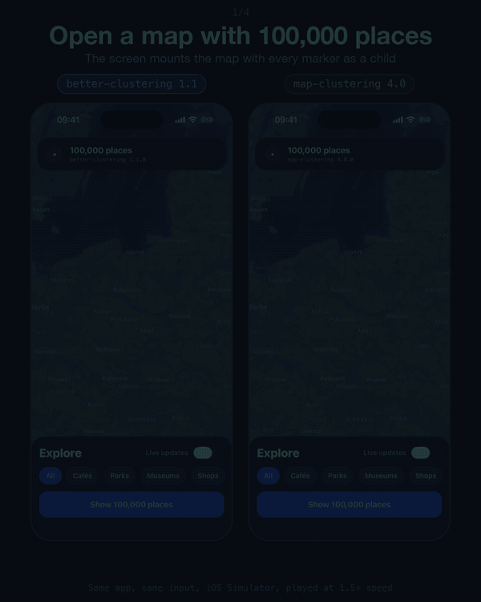

<div align="center">

**Your `react-native-maps` screen freezes with thousands of markers? Change one import.**

A drop-in replacement for **[react-native-map-clustering](https://github.com/tomekvenits/react-native-map-clustering)**. Same API, same `react-native-maps` workflow, but the cluster index is built in **C++ via [Nitro](https://nitro.margelo.com/)** on a background thread, not in JavaScript on the JS thread.

[](https://www.npmjs.com/package/react-native-better-clustering)
[](https://www.npmjs.com/package/react-native-better-clustering)
[](https://github.com/gmi-software/react-native-better-clustering/stargazers)
[](https://reactnative.dev/architecture/landing-page)
[](./LICENSE)
[](https://github.com/gmi-software/react-native-better-clustering/actions/workflows/ci.yml)

[Benchmark](#benchmark) • [Migration](#migration) • [Installation](#installation) • [Usage](#usage) • [Documentation](https://gmi-software.github.io/react-native-better-clustering/docs/intro) • [Example app](./example)

</div>

<div align="center">
  
  <br />
  <sub>The published 1.1.0 and react-native-map-clustering 4.0.0 in the same app, with the same input: opening 100,000 markers, pan and zoom on a screen that keeps the places in view in its state, a category filter, and a live fleet. iOS Simulator; each scene says its playback speed, and the times shown are real seconds.</sub>
</div>

## Benchmark

The same app, the same markers, the same cluster bubble, both libraries with their default props. Medians of 5 runs of a Release build (Hermes), from the [device benchmark](./example/bench):

| Markers | | First markers on the map | Longest JS freeze while mounting | JS blocked over 10 parent re-renders |
| --- | --- | --- | --- | --- |
| 10,000 | react-native-map-clustering 4.0.0 | 359 ms | 360 ms | 2,877 ms |
| | **react-native-better-clustering** | **193 ms** | **27 ms** | **0 ms** |
| 50,000 | react-native-map-clustering 4.0.0 | 1,834 ms | 1,835 ms | 17,794 ms |
| | **react-native-better-clustering** | **232 ms** | **92 ms** | **464 ms** |
| 100,000 | react-native-map-clustering 4.0.0 | 3,557 ms | 3,558 ms | 35,899 ms |
| | **react-native-better-clustering** | **434 ms** | **170 ms** | **1,719 ms** |

- **Mount.** react-native-map-clustering builds its index on the JS thread, so no touch, timer or state update runs until the first markers appear. Here the build runs on a background thread.
- **Re-renders.** With the same markers as new inline children, react-native-map-clustering rebuilds its index on every render. This library keeps the index and every mounted marker.
- **Zoom.** react-native-map-clustering queries four times the screen's area; at zoom 8 it renders about 3–4× as many markers and bubbles, most of them off screen.

Measured on the iOS Simulator (iPhone 17 Pro, Apple M5 Pro) against the 1.1.0 release candidate, which runs faster than a phone: compare the libraries, not the absolute times. The [full results](./example/bench/results/ios-simulator-2026-10-14/README.md) include memory, zoom and cluster presses. They also show where this library is slower: after a cluster press, the camera settles about 0.45 s later.

## Migration

```diff
- import MapView from 'react-native-map-clustering'
+ import MapView from 'react-native-better-clustering'
  import { Marker } from 'react-native-maps'
```

That is it. Your `<Marker>` children, cluster props, and `react-native-maps` options carry over. A few defaults and behaviours differ, such as the default cluster color and how `style` is applied: see [Migrating from react-native-map-clustering](https://gmi-software.github.io/react-native-better-clustering/docs/migration), and [Coming from 3.x](https://gmi-software.github.io/react-native-better-clustering/docs/migration#coming-from-react-native-map-clustering-3x).

## Fixes over react-native-map-clustering

| Issue                                                                                                                                                                                              | Status                                    |
| -------------------------------------------------------------------------------------------------------------------------------------------------------------------------------------------------- | ----------------------------------------- |
| Crash on `NaN` zoom ([#294](https://github.com/tomekvenits/react-native-map-clustering/issues/294))                                                                                                | Guarded with finite zoom fallback         |
| `Map size can't be 0` on Android ([#285](https://github.com/tomekvenits/react-native-map-clustering/issues/285))                                                                                   | Layout-aware `fitToCoordinates`           |
| `maxZoom` / `spiralEnabled` ignored ([#274](https://github.com/tomekvenits/react-native-map-clustering/issues/274), [#275](https://github.com/tomekvenits/react-native-map-clustering/issues/275)) | Implemented                               |
| Unstable clusters on zoom ([#255](https://github.com/tomekvenits/react-native-map-clustering/issues/255))                                                                                          | Stable cluster references between renders |
| Per-marker `cluster={false}` ([#297](https://github.com/tomekvenits/react-native-map-clustering/issues/297))                                                                                       | Supported                                 |

> [!CAUTION]
> Bugs in `react-native-maps` itself (ghost markers on Android, navigation crashes) may still occur. This library replaces clustering, not the map renderer.

## Installation

iOS and Android, React Native **0.78+** with the **New Architecture**, `react-native-maps` 1.20.1+ and `react-native-nitro-modules` 0.32.0+. Expo needs a [development build](https://docs.expo.dev/develop/development-builds/introduction/); Expo Go does not work. [Reanimated](https://gmi-software.github.io/react-native-better-clustering/docs/setup/installation#reanimated-optional) 4.1+ is optional: with it, cluster bubbles fade and glide on zoom.

```bash
npm install react-native-better-clustering react-native-nitro-modules react-native-maps
cd ios && pod install && cd ..
```

Rebuild the native app after installing. With Expo, install with `npx expo install` instead, add the `react-native-maps` config plugin with `androidGoogleMapsApiKey` (without it, Android apps crash when a map mounts), then `npx expo prebuild --clean` and build. See [Expo setup](https://gmi-software.github.io/react-native-better-clustering/docs/setup/installation#expo).

## Usage

```tsx
import MapView from 'react-native-better-clustering'
import { Marker } from 'react-native-maps'

export function MapScreen() {
  return (
    <MapView
      style={{ flex: 1 }}
      initialRegion={{
        latitude: 52.23,
        longitude: 21.01,
        latitudeDelta: 0.35,
        longitudeDelta: 0.35,
      }}
      onClusterPress={(cluster, markers) => {
        console.log(cluster.properties.point_count, markers.length)
      }}
    >
      {points.map((point) => (
        <Marker
          key={point.id}
          coordinate={{ latitude: point.latitude, longitude: point.longitude }}
        />
      ))}
    </MapView>
  )
}
```

Give each `Marker` a stable `key`, not the array index. `<Marker cluster={false} />` keeps a marker out of clusters.

## Documentation

| | |
| --- | --- |
| [Props](https://gmi-software.github.io/react-native-better-clustering/docs/api/mapview) | Every `MapView` prop, custom cluster bubbles with `renderCluster`, accessibility |
| [Installation](https://gmi-software.github.io/react-native-better-clustering/docs/setup/installation) | Platform setup, Google Maps keys, animated bubbles with Reanimated |
| [Migration](https://gmi-software.github.io/react-native-better-clustering/docs/migration) | Every difference from react-native-map-clustering, and coming from 3.x |
| [Advanced APIs](https://gmi-software.github.io/react-native-better-clustering/docs/api/hooks) | `useClusterer`, `Clusterer` and the headless engine, for your own map stack |
| [Performance](https://gmi-software.github.io/react-native-better-clustering/docs/performance) | What runs on which thread, the benchmarks and the roadmap |
| [Troubleshooting](https://gmi-software.github.io/react-native-better-clustering/docs/troubleshooting) | Blank maps, Expo Go, New Architecture errors, flickering markers |
| [Example app](./example) | Scenarios from 2,000 to 50,000 markers, and the device benchmark |

## Contributing

See [CONTRIBUTING.md](./CONTRIBUTING.md) for the setup, checks and docs workflow. Releases are published from CI, see [RELEASING.md](./RELEASING.md). Report vulnerabilities privately, see [SECURITY.md](./SECURITY.md).

## License

MIT, see [LICENSE](./LICENSE).

---

<div align="center">

Built and maintained by [GMI Software](https://gmi.software/open-source). If it saves your map screen, a ⭐ helps other React Native developers find it.

</div>
